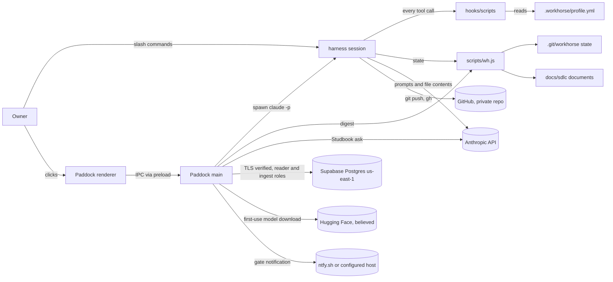

# Codebase map: WorkHorse

> **2026-10-13: Paddock (`desk/`) has been removed from this repository.** Everything below about
> Paddock describes it as it was. Its code stays in git history and in the public `paddock-snapshot`.

Written by wh-discovery-analyst on 2026-09-27 at commit 0ec0a97 (branch `master`). Every claim is
labelled **confirmed** (observed by reading the file or running the command) or **believed** (not
verified). The repository holds three things: the WorkHorse plugin, the Paddock desktop app, and
the part of Studbook that runs inside Paddock. Studbook's Python reference, ingest pipeline and
eval harness live in a separate repository (`~/studbook`, `muhibm1/studbook`) and are
out of scope here (confirmed).

## Layout

| Path | What it is | Status |
|---|---|---|
| `.claude-plugin/` | `plugin.json` and `marketplace.json`, both at version 0.3.10; the marketplace points at `./` | confirmed |
| `agents/` | 28 agent definitions: 19 `wh-*`, 9 vendored `ecc-*` | confirmed |
| `skills/` | 25 skills: user commands (`onboard`, `run`, `approve`, ...) and policy skills (`wh-*`) | confirmed |
| `hooks/hooks.json`, `hooks/scripts/` | 10 hook scripts wired at 15 points (`bus-emit.js` added in 0.6); `lib.js` holds the YAML parser, glob matcher, state and gate logic | confirmed |
| `hooks/tests/run.js` | the plugin's main test runner: builds a throwaway git repo in the OS temp dir and asserts hook and CLI decisions; `hooks/tests/bus-broker.js` (0.6) runs the event-log tests that need a real broker | confirmed |
| `scripts/bus/` | the event log (0.6): a zero-dependency Kafka client, the outbox, and three consumers (approvals projector, run metrics, replay) | confirmed |
| `scripts/wh.js` | the state CLI every agent uses (767 lines, zero dependencies) | confirmed |
| `templates/` | profile, change documents, client CLAUDE.md | confirmed |
| `vendor/ecc/` | vendored ECC rule packs (MIT), upstream commit in `VENDORED.md` | confirmed |
| `ci/` | templates for client repos: `claude-review.yml` (headless reviewers), `incident-triage.sh`; not live in this repo | confirmed |
| `.github/workflows/ci.yml`, `.github/dependabot.yml` | this repo's CI and dependency updates | confirmed |
| `.githooks/pre-push` | local stand-in for CI; `core.hooksPath` is set to `.githooks` on this machine | confirmed |
| `desk/` | Paddock, Electron + React + TypeScript, version 0.5.1 | confirmed |
| `examples/hello-service/` | a tiny Node HTTP service used as the sample client repo | confirmed |
| `docs/` | `STATUS.md`, design specs under `docs/superpowers/`, ECC adoption notes | confirmed |

## Stack

- Plugin: plain CommonJS Node, no dependencies, `engines: node >=18`. Root `package.json` has two
  scripts, `test` and `validate` (confirmed).
- Paddock: Electron 44.4.0, electron-vite 5, Vite 7, React 19.3, zustand 5, TypeScript 5.9.3,
  vitest 5.0.1, Playwright 1.63, ESLint 10 with typescript-eslint and react-hooks. All versions
  pinned exactly (confirmed, `desk/package.json`). Node 22.12+ to develop (`.nvmrc` says 24); this
  machine runs Node 24.19.0 and npm 10.7.0 (confirmed).
- Runtime dependencies of Paddock that reach the network: `@anthropic-ai/sdk` 0.126.0, optional
  `@anthropic-ai/claude-agent-sdk` 0.3.273, `pg` 8.23.0, `@huggingface/transformers` 4.3.0
  (confirmed).
- No formatter is configured (confirmed: no Prettier or similar in either package).

## Commands (run from the repository root)

| Check | Command | Result on 2026-09-27 |
|---|---|---|
| Plugin tests | `npm test` | exit 0, 224 passed, 0 failed (confirmed) |
| Paddock unit tests | `npm --prefix desk test` | exit 0, 278 passed, 1 skipped; 2 files skipped (Studbook parity gates, need a live database) (confirmed) |
| Combined `test` | `npm test && npm --prefix desk test` | exit 0 (confirmed) |
| One test file | `npm --prefix desk test -- tests/clock.test.ts` | exit 0, 8 passed. The path must be relative to `desk/`; `desk/tests/...` finds no file (confirmed) |
| Typecheck | `npm --prefix desk run typecheck` | exit 0 (confirmed) |
| Lint | `npm --prefix desk run lint` | exit 0 (confirmed) |
| Dependency audit | `npm --prefix desk audit` | exit 0, 0 vulnerabilities (confirmed) |
| Plugin manifest | `claude plugin validate .` | exit 0, "Validation passed" (confirmed) |
| Install | `npm --prefix desk ci` | not run: it would replace the `desk/node_modules` junction (believed to work) |
| Build | `npm --prefix desk run build` | not run: copies the plugin into `desk/resources/plugin`, then builds `desk/out` (believed) |
| E2E | `npm --prefix desk run e2e` | not run: needs a build and `claude` on PATH (believed) |

The plugin's test runner has no per-file mode (confirmed).

## Architecture

### The plugin path (a WorkHorse run in any repository)

1. The user types a slash command. The harness loads the skill (`skills/<name>/SKILL.md`), which
   dispatches agents from `agents/` (confirmed).
2. Agents read and write state only through `node scripts/wh.js`. Control state lives in
   `.git/workhorse/` (never committed); documents live in `docs/sdlc/<change-id>/` (confirmed,
   README and `wh.js` header).
3. Every tool call passes the hooks in `hooks/hooks.json`. They read `.workhorse/profile.yml` via
   `lib.js loadContext` and allow, ask, or deny (confirmed). The hooks are the enforcement layer:
   `protect-paths`, `bash-guard`, `gate-guard`, `test-lock`, `worktree-fence`, `artifact-check`,
   `verify-before-stop`, `format-on-write`, `session-context`.
4. Approvals are recorded by `wh.js approve`, which appends to `approvals.md` with the git
   `user.email`, the time and the artifact hash, and commits it (confirmed, `wh.js` line 325 and
   `hooks/tests/run.js`).

### The Paddock path (desktop app)

1. Main process (`desk/src/main/index.ts`) sets a strict CSP (`connect-src 'none'` in the built
   app), denies navigation, window creation and every permission request, and creates a sandboxed,
   context-isolated window (confirmed).
2. The renderer talks to main only through the preload bridge and named IPC channels
   (`desk/src/shared/types.ts`, `IPC` constant) (confirmed).
3. Runs: `drivers/cli.ts` spawns `claude -p ... --plugin-dir <plugin> --permission-mode acceptEdits
   --allowedTools <list>` with an argument array; `drivers/sdk.ts` uses the Agent SDK with the
   stored API key (confirmed). The allowed tools are limited to `ALLOWED_TOOL_CATALOG` in
   `settings.ts` (confirmed).
4. State: `watcher.ts` (chokidar) watches each registered repo and calls `wh.js digest --json
   --all` through `wh.ts` (confirmed). Gate approvals from the Gate screen also go through `wh.js`
   (believed from `runWh` wiring in `ipc.ts`).
5. Autopilot (`autopilot.ts`): resumes after a usage-limit stop, warns on a stalled run, and POSTs
   a gate notification to a user-configured ntfy-style URL (confirmed).
6. Studbook tab (`desk/src/main/studbook/`): hybrid retrieval over a Postgres/pgvector store,
   local embedding and reranking models, and answers from Claude (details under Data).

## Patterns to follow (with examples)

| Concern | Pattern | Example |
|---|---|---|
| Validation at a boundary | allowlist, drop anything unexpected | `desk/src/main/settings.ts` `sanitisePatch`, `sanitiseNotifyUrl` |
| Secrets | encrypted with Electron `safeStorage`, read only in main, never in an IPC return | `desk/src/main/settings.ts` `readApiKey`, `readStudbookConninfo` |
| Child processes | explicit argument array, never a shell string | `desk/src/main/drivers/cli.ts`, `desk/src/main/wh.ts` |
| Test seams | dependency injection of clients, clocks, spawn and fetch | `desk/src/main/autopilot.ts`, `studbook/index.ts` `connect` |
| Errors | fail closed with a human-readable message | `studbook/index.ts` refuses to connect without the CA file |
| Hook decisions | `L.deny`, `L.ask`, `L.emit({})` | `hooks/scripts/bash-guard.js` |
| Tests | Paddock: `desk/tests/*.test.ts` (vitest, node env); plugin: `check(name, cond)` in `hooks/tests/run.js`; e2e: `desk/e2e/smoke.spec.ts` | confirmed |
| CI count guards | CI asserts at least 140 plugin and 240 Paddock tests passed, so a suite that skips to green fails | `.github/workflows/ci.yml` |
| Release record | a changelog entry per version is enforced by tests | `hooks/tests/run.js` "changelog", `desk/tests/changelog.test.ts` |
| Logging | none beyond `console.warn`/`console.error` in main; no error tracking | believed, from grep |

## Data inventory

No end-user personal data by design (confirmed: no user tables, accounts or forms anywhere in the
repo). What data exists:

| Data | Where it lives | Personal or sensitive? | Flows to |
|---|---|---|---|
| Source code and SDLC documents of this repo | local disk; GitHub `muhibm1/workhorse` (private) | no | GitHub (push); Anthropic (agents read files into prompts); Studbook store (if this repo is synced) |
| Operator identity: name and email in `.claude-plugin/*.json`; git author email in 117 commits | the repo and its history | personal data of the operator only | GitHub; Anthropic when read |
| `approvals.md` in client repos (approver git email, time, artifact hash) | each repo's `docs/sdlc/<id>/` | operator's email | GitHub of that repo; Studbook store (doc type `approvals`) |
| Control state `.git/workhorse/` | local only, never committed | no | nowhere (confirmed, README) |
| Paddock `registry.json` (local repo paths) | `%APPDATA%\Paddock` | no | nowhere |
| Paddock `settings.json` (backend, allowed tools, notify URL) | `%APPDATA%\Paddock` | the notify URL is a private topic; treat as a secret | nowhere |
| Anthropic API key | `%APPDATA%\Paddock\settings.key.bin`, encrypted with safeStorage | secret | Anthropic, as the SDK driver's `ANTHROPIC_API_KEY` and for Studbook |
| Studbook reader and ingest connection strings | `studbook.conninfo.bin`, `studbook.ingest.conninfo.bin`, encrypted | secret | Supabase |
| Studbook corpus: markdown under `docs/sdlc/`, root README, root and component CHANGELOGs, `docs/superpowers/`, and every commit message (hash, date, body; not author) of each synced repo | Supabase Postgres us-east-1, schema `studbook`: `documents`, `chunks` (text plus embeddings), `eval_runs` | contains approver emails and any client wording in SDLC documents | written by Paddock's Refresh (ingest role); read by the Studbook tab (reader role) |
| Studbook questions, thread history, retrieved passages | in memory | may quote client SDLC documents | Anthropic API, model `claude-haiku-4-5`, for rewrite and answer |
| Embedding and reranker models (`Xenova/bge-base-en-v1.5`, `Xenova/bge-reranker-base`) | `%APPDATA%\Paddock\studbook-models` | no | downloaded once, believed from huggingface.co (transformers.js default) |
| Gate notification: repo name, change title, tier, phase, gate | not stored | change titles may name client work | ntfy.sh, or another https host the owner confirms in a dialog |
| Notion tracker digest (title, status, tier, verification, branch, PR, waiting-on) | Notion, only if `tracker.provider` is set | change titles | Notion (not configured for this repo) |

On this machine, `%APPDATA%\Paddock` holds only `registry.json` and `settings.json` plus Electron
caches: no key file, no conninfo files and no model cache (confirmed by listing). `settings.json`
has a notify URL set and `pluginPath` unset (confirmed, keys only, values not read). Registered
repos: `webapp`, `Portfolio`, `studbook` (confirmed).

Supabase store facts come from `studbook/docs/hosted-config.md`, last checked 2026-09-18: one
project, us-east-1, no grants to `anon` or `authenticated`, no functions, RLS on all three tables,
reader and ingest roles only (confirmed from that document; not re-queried here).

Secrets in git: `git ls-files` shows no `.env*`, key, token or credential file. The only match is
`desk/resources/studbook/supabase-ca.pem`, which is a public root certificate with no private key
(confirmed: `BEGIN CERTIFICATE`, zero `PRIVATE` lines). A content scan of tracked files for common
key and connection-string patterns found only obvious test fixtures in `desk/tests/studbook.test.ts`
(confirmed).

## Boundaries

- HTTP out: Anthropic API, Supabase Postgres (TCP with verified TLS), Hugging Face (believed),
  ntfy, GitHub (git and `gh`), npm registry (install and audit).
- No HTTP in: nothing listens on a port (confirmed for Paddock's main; the renderer's dev CSP
  allows localhost only for the Vite dev server).
- File system: the watcher reads registered repos; `wh.js` writes `docs/sdlc/` and `.git/workhorse/`.
- Processes: `claude`, `node`, `git` spawned with argument arrays.

## Tests layout

- `hooks/tests/run.js`: one file, about 224 checks over hooks, CLI, agent and template structure.
- `desk/tests/`: 24 vitest files; `studbook.gate.test.ts` and `studbook.chunks.gate.test.ts` skip
  unless `STUDBOOK_DATABASE_URL`/`STUDBOOK_DEV_JSONL` or `STUDBOOK_CHUNKS_JSON` are set, and say so.
- `desk/e2e/smoke.spec.ts`: Playwright against the built app; CI runs it under xvfb.
- `desk/fixtures/`: recorded stream-json for the normaliser tests.
