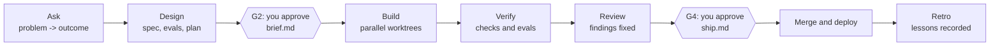

# WorkHorse: solution brief

For engineering leaders deciding whether to let AI agents ship changes into a production codebase.
Muhammad Muhibullah, 2026-09-30. Every number below is taken from a file in this repository or in a
repository WorkHorse has run on, cited inline.

## The problem

AI coding agents can now write most of a change. What they cannot do on their own is leave the
evidence an engineering organisation needs before it merges that change: who asked for it, what was
decided and why, what was tested, what reviewers found, and who approved it. Without that record, a
team either reviews every line by hand and loses the speed, or stops reviewing and loses control.

## What WorkHorse does

WorkHorse is an agentic software delivery lifecycle, packaged as a harness plugin, that runs
inside any repository. You give it a problem and an outcome. Agents design, build, verify, review
and ship the change. A person makes two decisions: approve a one-page Design document before any
code is written, and approve a one-page Ship document before anything merges. Both can be answered
from a terminal or by replying `/approve` on the pull request from a phone. Every decision is
committed with who made it, when, the exact document approved, and a link to where it was said.



## Results

Measured from the runs' own logs and gate records.

| Change | Tier | Agent minutes against budget | Outcome |
|---|---|---|---|
| Client web app with authentication: type fix | 2 | 80 of 90 | Merged; 8 reviewers, 9 findings fixed; the build green for the first time in 17 days |
| Portfolio: pin the minimum Node version | 2 | 109 of 90 | Merged; 36 new tests; 10 findings fixed |
| Portfolio: phone-number redaction scanner | 2 | 103 of 90 | Merged; 34 eval cases; 6 findings fixed; 5 minutes waiting on a person |
| Example service: health endpoint | 0 | 40 of 15 | Merged; 11 tests; 3 findings fixed |
| Studbook: MCP server for the record | 2 | 250 of 90 | Rejected once at the Ship gate, reworked, merged; 12 of 12 findings fixed |

Five of five merged, tested and documented, with 40 review findings fixed before a person signed
off. On the runs measured in `docs/STATUS.md`, every human touch was one of the two designed ones,
no run stopped to ask a question, and no Ship document reached a person with an open finding. The
next run, deep links on every route of the portfolio site, was the first inside its budget: 63 of
90 minutes, 33 eval cases, 4 findings fixed.

The plugin itself is held to the same standard: 323 tests in its own runner at the latest change,
and CI fails if fewer than 140 run (`.github/workflows/ci.yml`).

## How it earns trust

**Rules are code, not prompts.** Nine hook scripts sit between the agents and the repository. They
refuse edits to protected paths, test edits while a fix is in progress, a push or merge while a
required gate is unapproved, any approval attempted by an agent, and a Ship document that still
carries a blocker. A prompt can be argued with. A hook cannot.

**Each agent has one job and limited powers.** Twenty-eight single-purpose agents: the verifier
cannot edit code, the fixer cannot touch tests, reviewers cannot fix, and no agent can approve.
Reviewers scale with risk, from one on a documentation change to every specialist on a regulated one.

**Risk decides depth.** Every change is tiered from 0 (documentation) to 3 (regulated or
irreversible). Tier sets which gates apply, whether the security review is mandatory, whether
rollback is rehearsed, and the time budget the run is measured against.

**Nothing waits on a question.** Agents never stop mid-run to ask. Every open question becomes a
decision row in the Design document with a recommendation, and approving the document accepts the
recommendations unless the approver says otherwise.

**The record is the product.** Spec, evals, plan, architecture decisions, verification logs,
reviewer reports, the Ship document and a retro are committed under `docs/sdlc/<change>/`, so an
auditor, a new engineer, or I six months later can reconstruct any change.

## The decision that shaped it

The first version had five human gates, one per phase. I measured three real changes from their own
timestamps. On runs where agents worked 7 hours, 3 hours 40 minutes and 1 hour 45 minutes, a person
waited 41, 10 and 17 hours, and every approval note on the smallest change read "none"
(`docs/superpowers/specs/2026-09-19-two-gates-design.md`, section 1). Two thirds of the wall clock
was a person at a checkpoint with nothing to decide. I cut five gates to two and kept the rigour by
moving it into hooks and documents capped at a length a person actually reads. The other key
decisions and what each one cost are in [decisions.md](decisions.md).

## Limits

- Approvals are trusted to come from a person because the approve command cannot run from an
  agent; the main session model could still be talked into running it, so the approvals history in
  git is the audit source.
- Most hooks fail open with a warning so a broken hook cannot stall work; the gate hook fails closed.
- Gates on GitHub depend on the GitHub CLI and a watcher process on a machine that is awake.
- Runs still exceed budget more often than not: four of the five changes above did. The budget is
  a measurement, not a cap, and the overruns are what drove the 0.3.12 to 0.3.14 speed work.
- One engineer has run it, across a handful of repositories. It has not been run by a team.

## What your team would own

A profile per repository (commands, protected paths, compliance regimes, tier floors), the two
gate decisions per change, and the retro proposals, which arrive as diffs to accept or reject
rather than silent changes.

## Try it in ten minutes

Requires Node 18 or newer, git, the harness and the GitHub CLI.

```bash
claude plugin marketplace add <path-to-this-repository>
claude plugin install workhorse@workhorse --scope user
workhorse doctor
```

Then, inside a repository: `/workhorse:onboard`, followed by
`workhorse "<problem> -> <outcome>"`. The run stops at the Design gate and waits for you.
